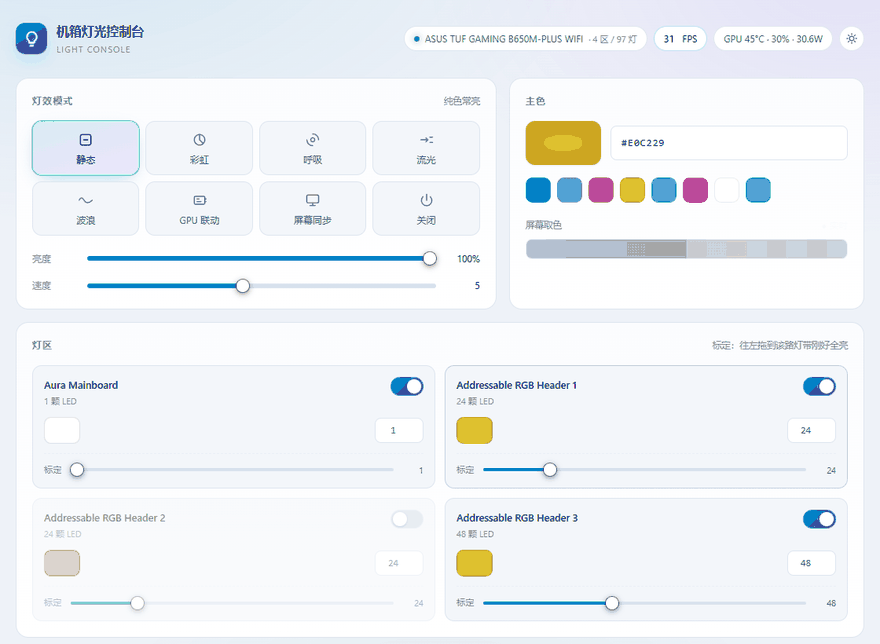
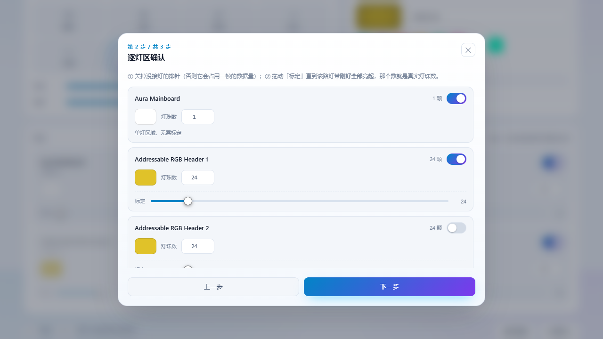
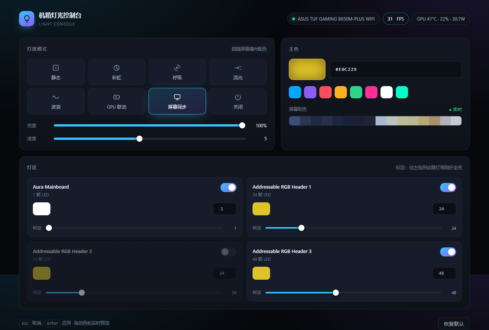
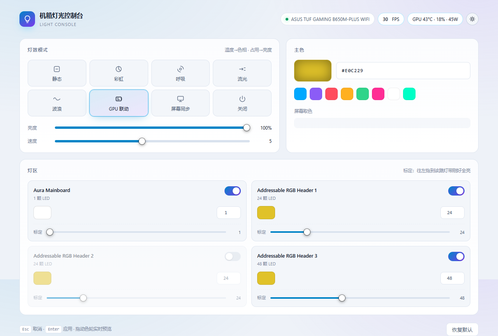

# Light Console · 机箱灯光控制台

**直接用网页控制主板 ARGB —— 不装 Armoury Crate / Mystic Light / RGB Fusion。**

[](LICENSE)
[](#环境要求)
[](requirements.txt)
[](https://github.com/CalcProgrammer1/OpenRGB)

[English](README.md) · [简体中文](README.zh-CN.md)



通过 OpenRGB 的 SDK 套接字驱动主板灯控，把它变成一个本地网页控制台：HSV 色轮、84 格调色盘、
逐灯区配色与灯珠数标定、8 种灯效、白日/黑夜主题，以及首次运行向导。

两个灯效**完全不需要额外硬件**：

| 灯效 | 说明 |
|---|---|
| **GPU 联动** | 读 `nvidia-smi` 的温度/占用/功耗。温度决定色相（蓝 → 红），占用决定亮度。 |
| **屏幕同步** | 把屏幕横向切成 16 段取平均色映射到灯珠，风扇上会出现与屏幕从左到右一致的色带。 |

---

## 目录

- [功能](#功能)
- [环境要求](#环境要求)
- [安装](#安装)
- [快速开始](#快速开始)
- [最容易踩的两个坑](#最容易踩的两个坑)
- [配置](#配置)
- [命令行](#命令行)
- [故障排查](#故障排查)
- [兼容性与适用范围](#兼容性与适用范围)
- [目录结构](#目录结构)
- [关于 OpenRGB 补丁](#关于-openrgb-补丁)
- [参与贡献](#参与贡献)
- [许可证](#许可证)

---

## 功能

- **8 种灯效** —— 静态、彩虹、呼吸、流光、波浪、GPU 联动、屏幕同步、关闭。
- **逐灯区控制** —— 每个灯区独立的开关、配色、灯珠数。关掉某个灯区只是给它推黑色，其它灯区不受影响。
- **调色盘** —— HSV 色轮 + 84 格调色盘，拖动时灯光实时跟随，支持 HEX/R/G/B 输入，
  自动记住最近 14 个颜色。
- **灯珠数标定** —— 可寻址排针在标定前会报 `0` 颗灯。用带实时 resize 的滑条解决。
- **白日 / 黑夜主题** —— 首次访问跟随系统偏好，记住你的选择，且不会出现主题闪烁。
- **首次运行向导** —— 列出 OpenRGB 枚举到的控制器，逐灯区引导标定，写入 `config.json`。
- **命令行工具** —— `scripts/control.py` 覆盖界面的全部能力，方便脚本化。
- **默认安全** —— 只监听 `127.0.0.1`，数据不出本机。

## 环境要求

| 项 | 要求 |
|---|---|
| 系统 | Windows 10 / 11（依赖 `nvidia-smi` 与 Windows 进程 API） |
| Python | 3.10 或更高 |
| OpenRGB | 1.1 便携版，由 `scripts/fetch_openrgb.ps1` 自动下载 |
| 显卡遥测 | 带 `nvidia-smi` 的 NVIDIA 驱动（可选，只有 GPU 联动需要） |

> 常规 HID 路径**不需要管理员权限**。以管理员身份运行 OpenRGB 只对 SMBus 设备（内存条、
> 部分 AIC 显卡）有意义，本项目不使用该路径。

## 安装

```powershell
git clone https://github.com/HoulinGu0/light-console.git
cd light-console

# 1) 下载官方 OpenRGB 便携版（校验 SHA-256，约 22 MB）
pwsh -File scripts/fetch_openrgb.ps1

# 2) 安装 Python 依赖
pip install -r requirements.txt
```

仓库**不收录** OpenRGB 二进制。`assets/OpenRGB/` 已被 `.gitignore` 排除，由下载脚本填充。

## 快速开始

```powershell
python scripts/server.py
# 或者直接双击 启动灯光控制台.cmd
```

服务会：

1. 复用 `127.0.0.1:6742` 上已在运行的 OpenRGB，否则以 `--server` 拉起自带的那个；
2. 在 <http://127.0.0.1:8099/> 提供控制台；
3. 自动打开浏览器。

**首次运行会弹出向导**：列出控制器与灯区 → 逐路灯区确认开关与灯珠数 → 写入 `config.json`。
之后随时可在底部点 **重新配置** 再跑一遍。

| 向导 | 主界面（黑夜） | 主界面（白日） |
|---|---|---|
|  |  |  |

## 最容易踩的两个坑

**1. 可寻址排针在标定前报 0 颗灯。**
OpenRGB 无法知道你灯带上到底有几颗灯。拖动 **标定** 滑条直到该路灯带刚好全亮并停手，
那个数字就是真实灯珠数。填错会引出两类完全不同的故障：

| 灯珠数 | 现象 |
|---|---|
| **填小了** | 链路末尾永远不亮（常见于风扇内圈）。 |
| **填大了** | 流光/彩虹有一部分行程落在不存在的灯珠上，看起来像"跑一段就停住"。 |

**2. 顶部显示的是「RGB 控制器名」，不是主板型号。**
OpenRGB 上报的是控制器自己的名字。华硕 Aura 恰好用板名命名；技嘉/微星/华擎通常上报
`RGB Fusion 2.0` / `Mystic Light` / `Polychrome`，或者干脆是芯片名。
把鼠标悬停在设备胶囊上可以看到厂商、灯区数和本轮枚举到的控制器数量。

## 配置

配置写在项目根目录的 `config.json`，由向导生成。

```jsonc
{
  "setup_done": true,          // 改成 false 下次打开会重新弹向导
  "mode": "static",            // static | rainbow | breathe | chase | wave | gpu | screen | off
  "color": "#00A8FF",
  "brightness": 100,           // 0-100
  "speed": 5,                  // 1-10
  "device": "",                // 留空=自动挑选；填名称片段可强制指定控制器
  "zones": {
    "addressable_rgb_header_1": { "enabled": true, "color": "#00A8FF" }
  },
  "leds": { "addressable_rgb_header_1": 24 }   // 0 表示尚未标定
}
```

灯区键名由 OpenRGB 上报的灯区名经 `slug(name)` 生成，**不写死任何厂商命名** ——
控制器有几个灯区就生成几个键。完整字段说明与旧配置迁移规则见
[docs/CONFIGURATION.md](docs/CONFIGURATION.md)。

## 命令行

```bash
python scripts/control.py list                        # 列出控制器/灯区/可用灯效
python scripts/control.py set --color 00A8FF          # 全部灯区刷色
python scripts/control.py set --zone header1 --color FF3B30 --leds 60
python scripts/control.py mode --name Rainbow         # 用控制器自带灯效（不吃 CPU）
python scripts/control.py off
python scripts/control.py anim --effect rainbow --seconds 30
python scripts/control.py sweep --leds 60             # 三路排针刷不同颜色，用于定位接线
python scripts/control.py snapshot / restore          # 保存 / 回滚状态
```

## 故障排查

| 现象 | 处理 |
|---|---|
| `OpenRGB SDK 不可用` | 先跑 `pwsh -File scripts/fetch_openrgb.ps1`，再确认 6742 端口没被别的进程占着。 |
| 界面里没有灯区 | OpenRGB 没识别到控制器，查 `%APPDATA%\OpenRGB\logs`。 |
| 某路灯珠不亮 | 该灯区的开关可能被关了，或灯珠数是 0（未标定）。 |
| 风扇内圈不亮 | 灯珠数偏小，调大。 |
| 流光像在卡顿/停顿 | 灯珠数偏大，调到「刚好全亮」为止。 |
| GPU 胶囊显示 `—` | `nvidia-smi` 缺失或执行失败，跑 `scripts/diag_gpu_poll.py`。 |
| 屏幕同步卡顿、接口超时 | `screen_worker.py` 没起来，检查 `%TEMP%\light_console_bands.json`。 |

更多见 [docs/TROUBLESHOOTING.md](docs/TROUBLESHOOTING.md)。

## 兼容性与适用范围

这是一个**针对单台机器调校的个人项目** —— ASUS TUF GAMING B650M-PLUS WIFI，
6 个 ARGB 机箱风扇（2 个接 Header 1、4 个接 Header 3），加一张 RTX 4080 SUPER Founders Edition。
它不是通用 RGB 管理器。

- HID 路径与 OpenRGB SDK 本身是厂商中立的，灯区键也会随控制器实际上报的灯区自动生成，
  所以别的板子通常能用 —— 但默认值、标定引导和文档都是围绕那一台机器写的。
- 只控制**接在主板 ARGB 排针上**的设备。用机箱自带控制器的灯不在范围内。
- 显卡自带的标识灯**无法**控制，原因见下节。

## 目录结构

```
light-console/
├── LICENSE                 GPL-3.0
├── README.md · README.zh-CN.md
├── requirements.txt · requirements-dev.txt
├── config.json             向导生成（已 gitignore）
├── 启动灯光控制台.cmd        一键启动
├── .github/                issue 与 PR 模板
├── docs/                   入门、配置、排错、开发笔记
├── patches/                OpenRGB 补丁（源码形式 + 二进制形式）
├── scripts/
│   ├── server.py           HTTP API + 灯效引擎
│   ├── index.html          全部前端（无构建步骤）
│   ├── control.py          命令行工具
│   ├── screen_worker.py    屏幕取色子进程
│   ├── fetch_openrgb.ps1   下载 OpenRGB 并校验 SHA-256
│   └── diag_*.py           开发期保留的诊断脚本
├── assets/                 下载后 OpenRGB 存放于此（已 gitignore）
├── evidence/               文档中引用的截图
└── runtime/                运行时产物（已 gitignore）
```

## 关于 OpenRGB 补丁

[`patches/`](patches/) 里是两行修复：让 OpenRGB 的 NVIDIA 照明探测接受 RTX 4080 SUPER
Founders Edition 的 `0x18CC` 变体。上游按 PCI 四元组精确匹配且只定义了 `0x18CB`，
所以探测会**静默跳过**这张卡。

补丁只让 OpenRGB 登记该控制器，**并不会**让标识灯变得可控 ——
`NvAPI_GPU_ClientIllumZonesGetControl` 在该驱动下依旧返回 `numIllumZonesControl = 0`。
提上游 issue 前请先读 [patches/README.md](patches/README.md)，里面也写了 GPL-2.0 的合规边界。

## 参与贡献

欢迎 issue 与 PR，动手前请先看 [CONTRIBUTING.md](CONTRIBUTING.md)。
涉及安全的问题请按 [SECURITY.md](SECURITY.md) 私下报告，不要开公开 issue。

## 许可证

[GPL-3.0](LICENSE)。这不是自由选择：本项目 `import` 了
[`openrgb-python`](https://github.com/jath03/openrgb-python)，它是 GPL-3.0，
因此整体必须以 GPL-3.0 发布。完整的依赖许可关系与"想改成 MIT 需要做什么"见
[docs/THIRD-PARTY.md](docs/THIRD-PARTY.md)。

## 致谢

- [OpenRGB](https://github.com/CalcProgrammer1/OpenRGB) —— 依赖的硬件层。
- [openrgb-python](https://github.com/jath03/openrgb-python) —— SDK 客户端。
- [mss](https://github.com/BoboTiG/python-mss) 与 [NumPy](https://numpy.org/) —— 屏幕采样。
