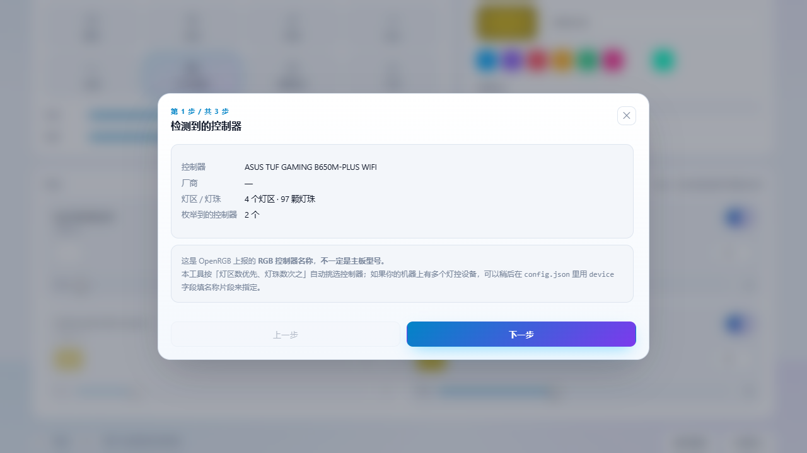
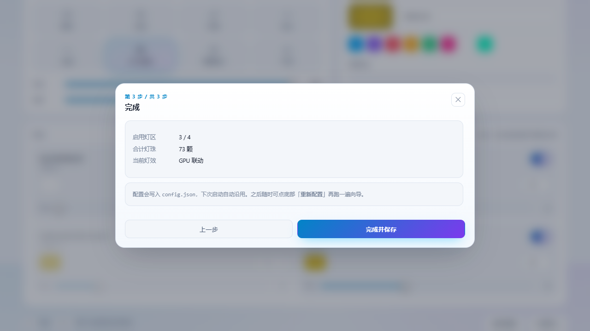

# 入门教程 · Getting Started

从零到"灯听你的话"，大约 10 分钟。本文假定你**从未接触过 OpenRGB**。

- 只想快速跑起来 → 看 [README](../README.zh-CN.md) 的「安装 / 快速开始」
- 想看每个配置项含义 → [CONFIGURATION.md](CONFIGURATION.md)
- 出问题了 → [TROUBLESHOOTING.md](TROUBLESHOOTING.md)

---

## 0. 你会得到什么

一个本地网页 `http://127.0.0.1:8099/`，上面能：

- 用色轮/调色盘改机箱灯颜色
- 逐路灯区开关、独立配色、标定灯珠数
- 切 8 种灯效，其中 **GPU 联动** 和 **屏幕同步** 不需要任何额外硬件

不改注册表、不装驱动、不接管系统服务。关掉窗口就停。

---

## 1. 前置检查（3 条命令，30 秒）

打开 **PowerShell**（不用管理员），依次执行：

```powershell
# Python 是否为 3.10+
python --version

# PowerShell 是否为 7+（用来跑下载脚本）
pwsh -version

# 主板上是否有可被 OpenRGB 识别的灯控（可选，没有也能装，装完再看）
Get-PnpDevice -PresentOnly | Where-Object { $_.FriendlyName -match 'AURA|RGB|LED' }
```

**期望结果**：`Python 3.10` 或更高、`PowerShell 7.x`、最后一条至少列出一个灯控设备
（华硕主板通常是 `AURA LED Controller`）。

> 如果 `pwsh` 不存在：安装 PowerShell 7，或者把后文所有 `pwsh -File xxx.ps1`
> 换成 `powershell -ExecutionPolicy Bypass -File xxx.ps1`。

---

## 2. 安装（4 步）

```powershell
# ① 取得代码
git clone https://github.com/HoulinGu0/light-console.git
cd light-console

# ② 下载官方 OpenRGB（约 22 MB，脚本会校验 SHA-256）
pwsh -File scripts/fetch_openrgb.ps1
```

正常输出末尾会看到：

```
[+] 校验通过
[+] 就绪: ...\assets\OpenRGB\OpenRGB Windows 64-bit\OpenRGB.exe
```

```powershell
# ③ 安装 Python 依赖
pip install -r requirements.txt
```

依赖只有三个：`openrgb-python`、`mss`、`numpy`。

```powershell
# ④ 启动
python scripts/server.py
```

看到 `[+] 控制台已启动: http://127.0.0.1:8099/` 就成功了，浏览器会自动打开。

> **也可以双击 `启动灯光控制台.cmd`**，效果一样，还省一个终端窗口。
> 关掉它 = 停止控制，灯会停在最后一帧。

---

## 3. 第一次启动：三步向导

首次运行会自动弹出向导。它做三件事：

### 第 1 步 · 确认控制器



显示 OpenRGB 枚举到的控制器、灯区数、灯珠总数，以及**一共枚举到几个控制器**。

> ⚠️ 这里显示的名字是 **RGB 控制器名**，不一定是主板型号。华硕 Aura 恰好用板名；
> 别家常见的是 `RGB Fusion 2.0` / `Mystic Light` / `Polychrome`。
> 机器上有多个灯控设备时，可以在 `config.json` 里给 `device` 填名称片段来指定。

### 第 2 步 · 逐灯区标定（最关键的一步）


对每个灯区做两件事：

1. **没接灯的排针，把开关关掉**（例如三路 ARGB 排针只用了两路）
2. **拖动「标定」滑条，直到该路灯带刚好全部亮起**

判断标准很简单：

| 现象 | 含义 | 怎么办 |
|---|---|---|
| 只有一部分风扇亮 | 灯珠数填小了 | 继续往右拖 |
| 全部亮了，再拖也没有新变化 | 已经到位 | 就停在这个数（或略小一档） |
| 流光跑着跑着有一段全黑 | 灯珠数填大了 | 往左调 |

### 第 3 步 · 完成



确认「启用灯区 / 合计灯珠 / 当前灯效」，点 **完成并保存**，配置写入 `config.json`。

> 以后想再跑：页面底部点 **重新配置**。

---

## 4. 验证灯真的在听你的（重要）

向导结束别急着调效果，先做一次**明确验证**：

```powershell
python scripts/control.py set --color FF0000
```

机箱应该**整体变红**。然后：

```powershell
python scripts/control.py set --color 00FF00    # 变绿
python scripts/control.py off                   # 全灭
```

三条都能对应上，说明链路完全通了。任一条不对，去 [TROUBLESHOOTING.md](TROUBLESHOOTING.md)。

> 这一步很值得做：它把「软件问题」和「灯珠数标定问题」分开了。

---

## 5. 挑一个灯效

界面上方 8 个按钮：

| 灯效 | 适合什么时候用 |
|---|---|
| 静态 | 想要一个固定颜色，最省事 |
| 彩虹 / 波浪 | 想看颜色在风扇之间流动 |
| 呼吸 | 夜间柔和，不刺眼 |
| 流光 | 彗尾追逐，速度可调 1–10 |
| **GPU 联动** | 想直观看到显卡负载 / 温度 |
| **屏幕同步** | 看电影、打游戏时氛围最强 |
| 关闭 | 临时全灭（不用拔线） |

### GPU 联动怎么验证它在工作

切到「GPU 联动」，看页面顶部胶囊：

```
GPU 43°C · 22% · 30.7W
```

这行是**每秒刷新**的真实读数。此时灯是**深蓝**（凉）。开个游戏或跑个渲染，温度上到 60–70°C，
灯会一路从绿变橙再变红，负载越高越亮。

> 没有 NVIDIA 显卡时这个胶囊会显示 `GPU —`，其它灯效不受影响。

### 屏幕同步怎么验证

切到「屏幕同步」，主色面板下方会出现一条**实时色带**（右上角 `● 实时` 点亮）。
这条色带就是屏幕的 16 段取色结果——浏览器窗口拖到哪侧、放什么内容，色带就跟着变，
风扇上出现的是同一条色带的映射。

> 只在屏幕同步模式下才抓屏，切到别的灯效后子进程会自动退出，零开销。

---

## 6. 常用操作

### 改颜色

点主色大色块 → 色轮或调色盘选色 → **应用**。
想给单个灯区单独配色：点灯区卡片左侧的色块。

### 白日 / 黑夜主题

右上角太阳/月亮按钮。首次访问跟随系统偏好，之后记住你的选择。

### 用命令行做一次性效果

```powershell
python scripts/control.py list                       # 看看有哪些灯区/灯效
python scripts/control.py set --zone header1 --color FF3B30
python scripts/control.py mode --name Rainbow        # 用控制器固件里的灯效，不吃 CPU
python scripts/control.py anim --effect rainbow --seconds 60
```

### 定位"哪个排针接的是哪组风扇"

```powershell
python scripts/control.py sweep --leds 60
```

三路 ARGB 排针会分别亮 **绿 / 蓝 / 红**。看机箱里哪组风扇变成哪个颜色，就知道接线了。

---

## 7. 让它开机自启（可选）

不想每次双击 `.cmd`：

```powershell
$action  = New-ScheduledTaskAction -Execute "powershell.exe" `
           -Argument '-NoProfile -WindowStyle Hidden -Command "cd ''C:\path\to\light-console''; python scripts/server.py --no-browser"'
$trigger = New-ScheduledTaskTrigger -AtLogOn
Register-ScheduledTask -TaskName "LightConsole" -Action $action -Trigger $trigger
```

删除：

```powershell
Unregister-ScheduledTask -TaskName "LightConsole" -Confirm:$false
```

---

## 8. 停止与回滚

| 想做什么 | 做法 |
|---|---|
| 临时停一下 | 关掉控制台窗口 / 结束 `python` 进程 |
| 灯停在最后一帧 | 正常现象，Aura 控制器会保持最后收到的状态 |
| 回到主板默认灯效 | 重启电脑进 BIOS，或装回 Armoury Crate 覆盖 |
| 清掉我的配置 | 删除 `config.json`，下次启动会重新弹向导 |
| 卸掉 OpenRGB | 直接删 `assets/OpenRGB/`（仓库不含它，删了不影响代码） |

本项目不写注册表、不装驱动、不注册服务（除非你自己建了第 7 步的计划任务）。
